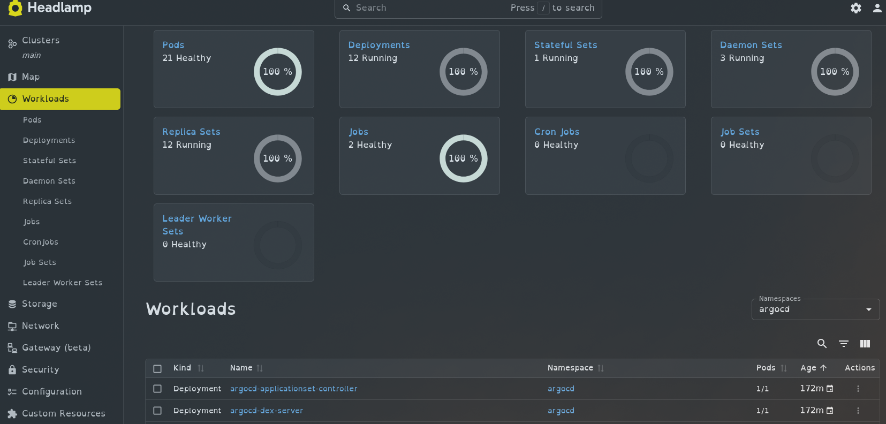
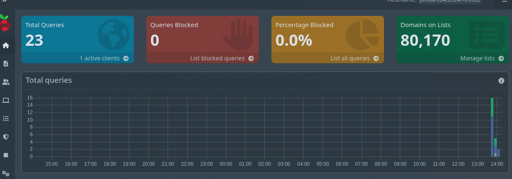

# Kubernetes

This directory handles the configuration for the apps in the K3s cluster.

I decided to use GitOps for this project. This is where the desired state is stored in Git and is constantly compared to whats currently running. Argo CD takes control of this and deploys all the apps.

### Argo CD :
Argo CD is installed by the bootstrap script.

After Argo CD is running it applies `argocd/root.yml` which acts as the root application for the cluster. This is the app of apps deployment design where one application manages multiple child applications.

`argocd/root.yml` tells Argo CD to watch `applications/` which contains all the applications Argo CD should deploy. Each file contains which Helm chart should be used and every `values.yml` file contains how that chart is configured.

A Deploy Key is required to be configured in GitHub for Argo CD to work.

## Headlamp
Headlamp provides a GUI for viewing and managing the cluster.

Exposed through Traefik at: `http://headlamp.homelab`





To access the UI, generate a token
```
kubectl create token headlamp-admin -n headlamp --duration=24h
```

## Pi-hole
Pi-hole acts as a DNS service, blocking ads and malicious domains.

Its DNS service is exposed from the cluster while the web interface is accessed through Traefik at: `http://pihole.homelab`



To get the password for the web ui:
```
kubectl get secret pihole-password \
  -n pihole \
  -o jsonpath="{.data.password}" | base64 --decode
```
To get Pi-hole to block ads on your network, you need to change your ISP's DNS address with the IP address of Pi-hole, but in my case my ISP does not allow me to change DNS server without workarounds.

## Monitoring

Monitoring is configured using `kube-prometheus-stack`, which includes Prometheus and Grafana.

Prometheus collects metrics from the Kubernetes cluster, while Grafana provides dashboards for viewing those metrics.

This allows me to monitor:

- Node CPU and memory usage
- Pod resource usage
- Kubernetes workload health
- Cluster resource usage
- Application availability

## Traefik

K3s includes Traefik, which handles access to the web applications running inside the cluster.

Instead of accessing each application through a different port, Traefik allows them to use their own hostname.

`request to headlamp.homelab` --> `traefik` --> `headlamp.svc` --> `headlamp pod`

```
argocd.homelab
headlamp.homelab
pihole.homelab
grafana.homelab
```